<div align="center">

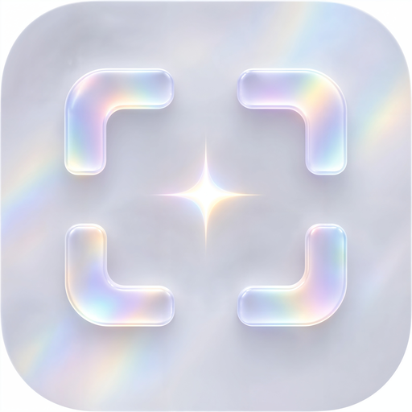

# StudyLens

**Point at a question. Understand the answer.**

A free, open-source study helper for Android, macOS and Windows. A floating lens reads the question on your screen and explains it — one at a time, or the whole page at once — with the working shown.

[](#download)
[](https://github.com/Asta39/studylense/releases/latest)
[](https://asta39.github.io/studylense/)
[](https://console.groq.com)

[Website](https://asta39.github.io/studylense/) · [Download](#download) · [Features](#features) · [Screenshots](#screenshots) · [Install](#install) · [Build from source](#build-from-source) · [Architecture](#architecture) · [Privacy](#privacy)

<br>

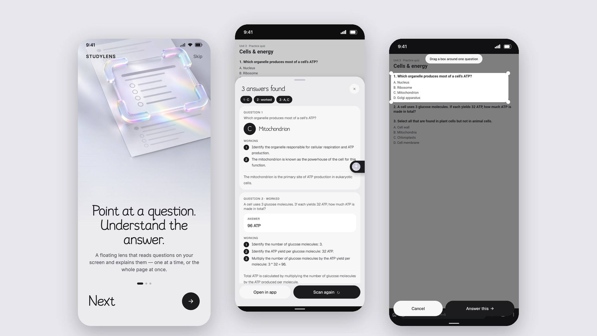

</div>

> [!IMPORTANT]
> **Educational use only.** StudyLens is a learning tool for studying, homework and practice. It must not be used for cheating or any other academic malpractice — not in exams, tests, quizzes or graded work, and not anywhere your school's rules don't allow it. See [Educational use only](#educational-use-only).

---

## Overview

StudyLens takes **one screenshot when you ask it to**, sends it to a vision model on [Groq](https://console.groq.com) with your own free API key, and shows the answer in a calm card on top of whatever you're reading. Multiple-choice questions get the letter and the option, calculations get the result for each part plus numbered working steps, and short-answer questions get a clean sentence. Every scan is kept in a local history for revision.

There's no StudyLens account and no server in between: your device talks to Groq directly.

## Download

| Platform | Requirements | Download |
|---|---|---|
| **Android** | Android 10+ | [StudyLens-Android.apk](https://github.com/Asta39/studylense/releases/latest/download/StudyLens-Android.apk) |
| **macOS** | macOS 14+, Apple silicon or Intel | [StudyLens-macOS.zip](https://github.com/Asta39/studylense/releases/latest/download/StudyLens-macOS.zip) |
| **Windows** | Windows 10 / 11, x64 | [StudyLens-Windows-x64.exe](https://github.com/Asta39/studylense/releases/latest/download/StudyLens-Windows-x64.exe) |

All versions and release notes: **[Releases](https://github.com/Asta39/studylense/releases)**. You'll also need a free **[Groq API key](https://console.groq.com/keys)**.

By downloading or building StudyLens you agree to use it for **educational purposes only**.

## Features

### Capturing
- **Full screen:** one screenshot, every question on it (usually two or three) answered in its own card, with a summary row on top
- **One question:** the screen freezes and dims; drag a box around a single question and tap **Answer this**
- **Android:** a glass lens bubble docked on the screen edge. Drag it, flick it to the other side, tap it for the menu
- **Windows:** a tray app with global shortcuts. **Ctrl + Alt + B** for one question, **Ctrl + Alt + Shift + B** for the whole screen
- **macOS:** a menu bar app. Hover over a question and press **⌃ ⌥ B**

### Answers
- **Typed answers:** the model tells StudyLens whether it's multiple choice, a short answer or a worked problem, and the card changes to match
- **Multiple choice:** letter badge plus the option text; select-all questions get every correct letter
- **Calculations:** each part — (i), (ii), (iii) — on its own line, then 2–5 numbered **Working** steps
- **Checked before shown:** the prompt makes the model verify its work, so you don't get "wait, let me recalculate" in the answer
- **Copy** an answer (question, result, steps and explanation) straight into your notes

### App
- **History:** every scan with its screenshot, grouped by day and filterable (searchable on Windows), with delete and clear all
- **Settings:** Groq key, automatic model choice, explanations on/off, bubble size (Android), card next to the question or a side panel (Windows), start with Windows
- **Auto model selection:** StudyLens asks Groq which models your key can use and picks one that reads images, falling back to the next if one is retired
- **Scales to any screen:** the Android UI keeps the design's proportions whatever the phone's display-size setting; Windows is per-monitor DPI aware

## Screenshots

### Android

| The lens | Choose a mode | Full screen | One question | The answer |
|:---:|:---:|:---:|:---:|:---:|
| 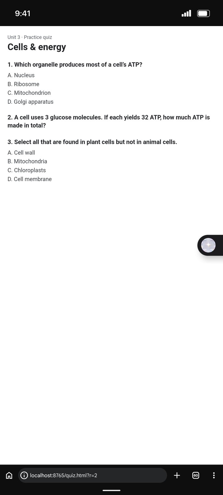 | 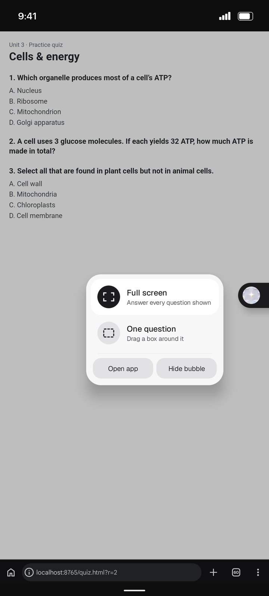 | 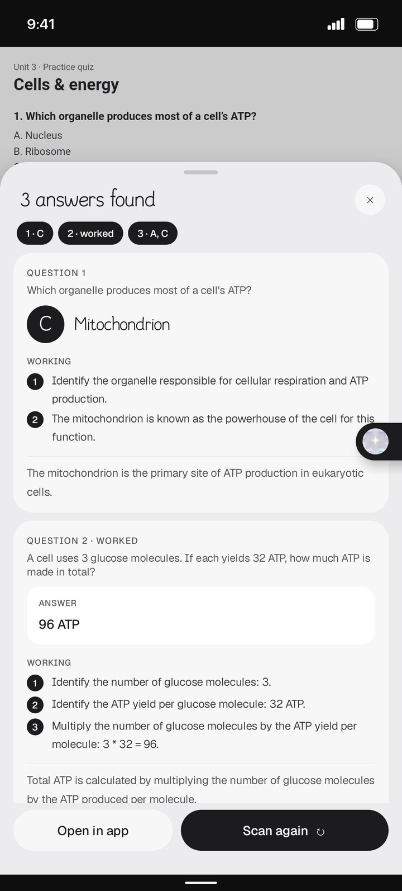 | 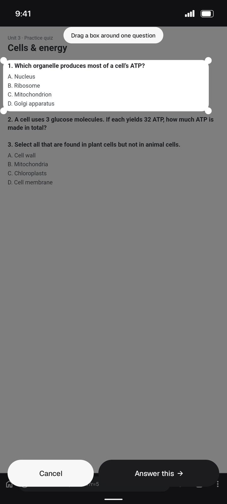 | 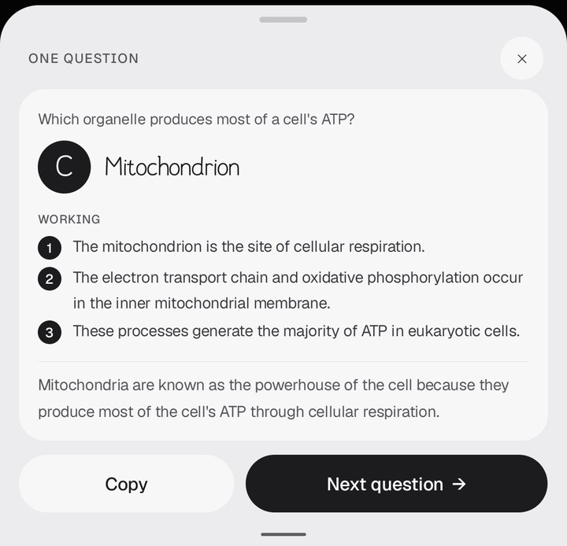 |

| Welcome | Setup | Home |
|:---:|:---:|:---:|
| 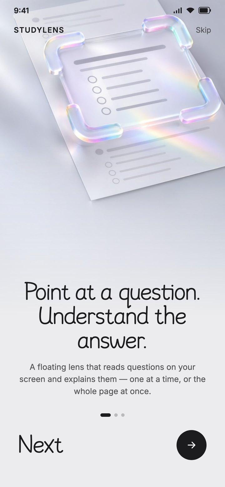 | 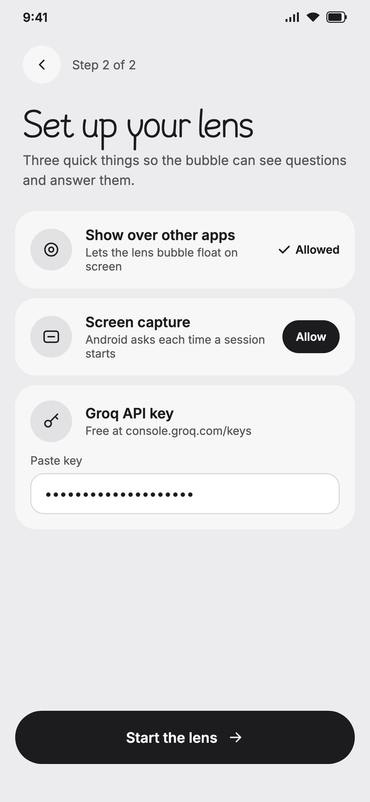 | 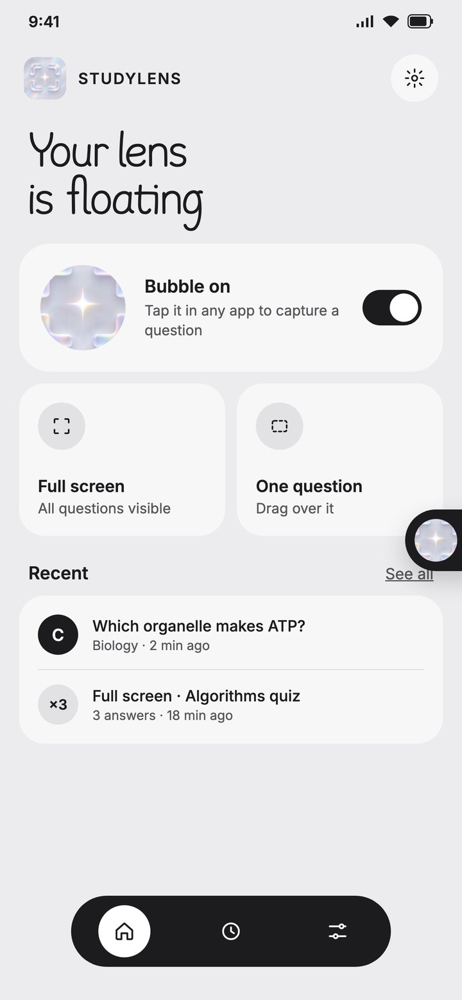 |

### Windows

| Full-screen answers | Answer card |
|:---:|:---:|
| 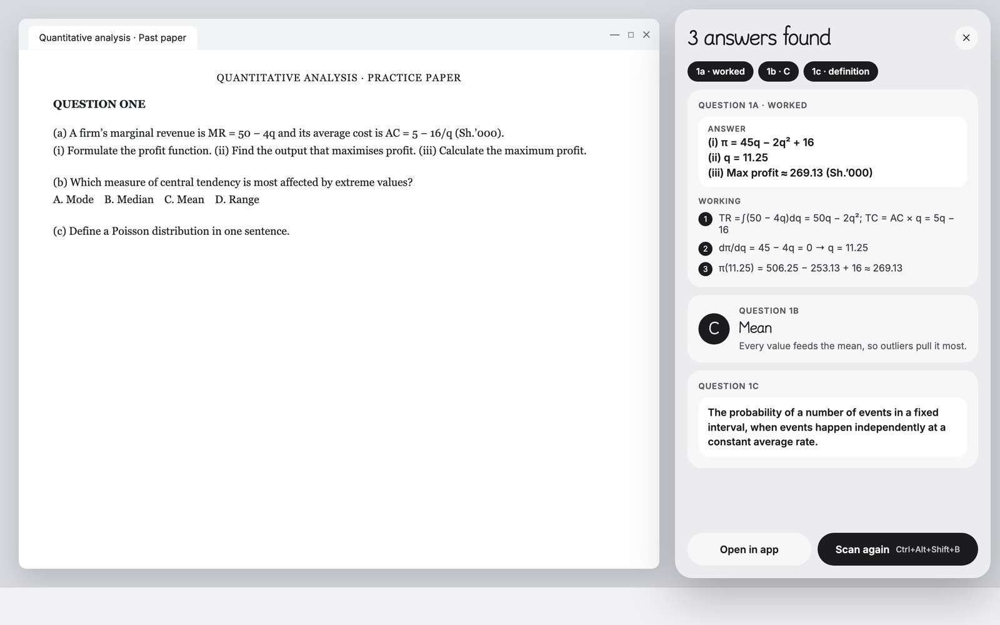 | 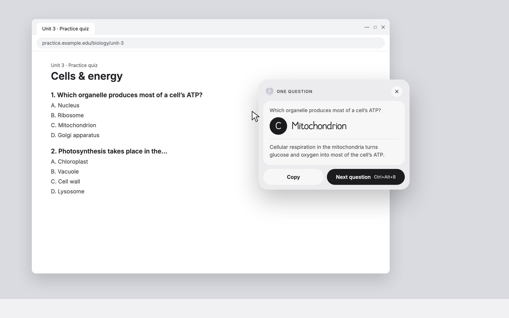 |
| **Tray menu** | **Drag over one question** |
| 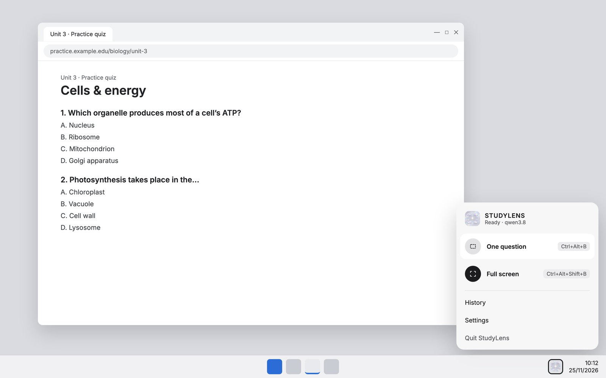 | 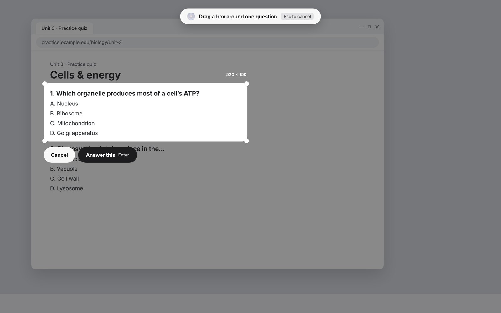 |
| **History** | **Settings** |
| 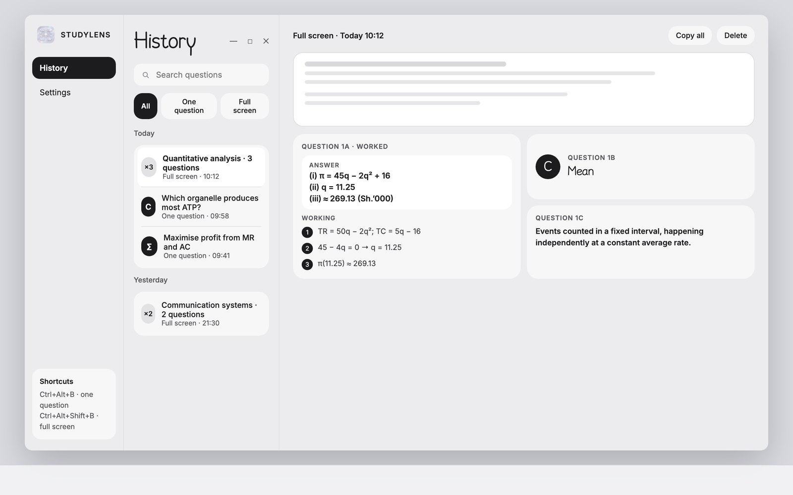 | 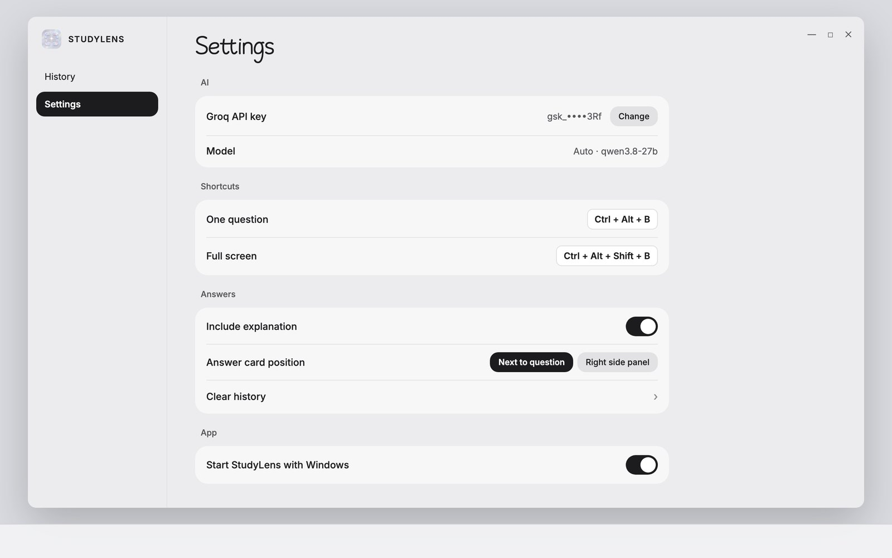 |

### macOS

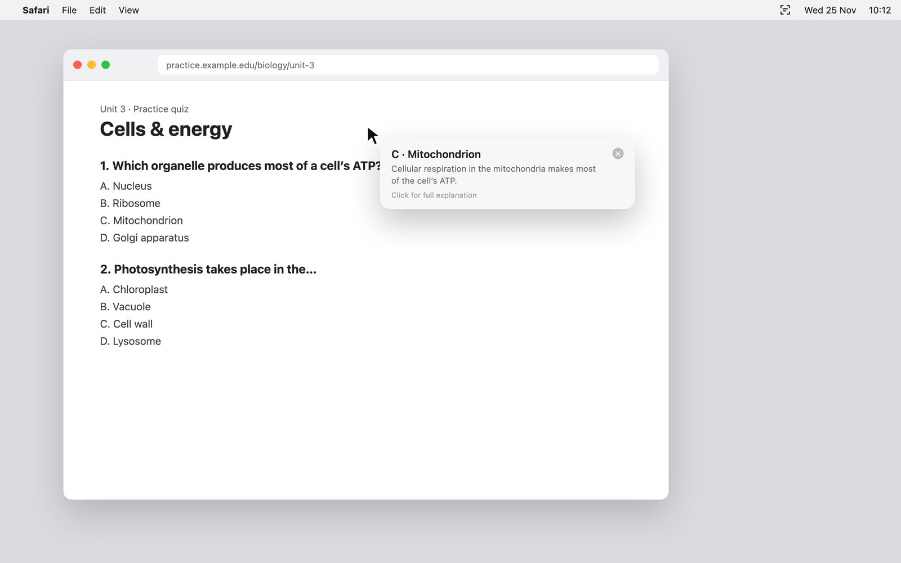

> The first row of Android screenshots is from the app running on a phone. Windows, macOS and the second Android row are rendered from the design files.

## Install

### Android
1. Download **StudyLens-Android.apk** and open it. Allow installs from your browser or file manager if asked.
2. In StudyLens, allow **Display over other apps**.
3. Turn on **StudyLens screenshots** in *Settings → Accessibility*. It takes one screenshot per tap and never records.
   If the switch is greyed out ("Restricted setting"), open *Settings → Apps → StudyLens → ⋮ → Allow restricted settings* first.
4. Paste your Groq key and tap **Start the lens**.

### macOS
1. Download **StudyLens-macOS.zip**, unzip and move **StudyLens** to *Applications*.
2. The build isn't notarised yet: right-click the app → **Open** the first time.
3. Allow **Screen Recording** in *System Settings → Privacy & Security*, then reopen StudyLens.
4. Click the menu bar icon and paste your Groq key.

### Windows
1. Download **StudyLens-Windows-x64.exe** and run it. Nothing to install.
2. On the SmartScreen prompt choose **More info → Run anyway** (the build isn't code-signed yet).
3. Paste your Groq key in the setup window. StudyLens then lives in the system tray.

## Build from source

<details>
<summary><b>macOS</b> — Swift, single file</summary>

```bash
cd mac
./build.sh          # universal (arm64 + x86_64) StudyLens.app, ad-hoc signed
open StudyLens.app
```
To keep the Screen Recording permission across rebuilds, sign with a stable identity: put a code-signing keychain at `mac/signing/studylens.keychain-db` and set `STUDYLENS_SIGN_ID`.
</details>

<details>
<summary><b>Android</b> — Kotlin + Jetpack Compose</summary>

Requires the Android SDK (API 36) and JDK 17.
```bash
cd android
./gradlew assembleDebug
adb install -r app/build/outputs/apk/debug/app-debug.apk
```
</details>

<details>
<summary><b>Windows</b> — C# / WPF, .NET 8</summary>

Builds on Windows, macOS or Linux with the .NET 8 SDK.
```bash
cd windows
dotnet publish -c Release -r win-x64 --self-contained true \
  -p:PublishSingleFile=true -p:EnableCompressionInSingleFile=true -o publish
```
</details>

## Architecture

```
mac/        Sources/main.swift — menu bar item, Carbon hotkey, ScreenCaptureKit capture, answer card panel
android/    MainActivity.kt    — Compose screens: welcome, setup, home, history, detail, settings
            BubbleService.kt   — overlay bubble, action menu, drag-to-select, answer sheets
            ShotService.kt     — accessibility service used only for takeScreenshot()
            Groq.kt, Store.kt  — model selection, prompt + JSON parsing; prefs + history
windows/    App.cs             — tray icon, RegisterHotKey, capture → Groq → answer flow
            Capture.cs         — monitor capture, per-monitor DPI placement, region select window
            Overlays.cs        — reading pill, answer card, side panel, tray menu
            MainWindow.cs      — setup, history (list + detail), settings
            Groq.cs, Store.cs
docs/       GitHub Pages site and README images
art/        4K icon and hero artwork
```

All three apps share the same flow: **capture → JPEG (≤2400 px) → Groq chat completion with the image → JSON answers → typed answer cards → local history**.

## Privacy

- Screenshots are taken **only when you trigger a capture**. Nothing is recorded.
- The screenshot goes from your device **directly to Groq** with your own key; there is no StudyLens server.
- History stays on your device (Android: app storage; Windows: `%AppData%\StudyLens`; macOS: memory only) and can be cleared in Settings.

## Educational use only

StudyLens is an **educational project**. It exists to help you understand questions while you study, revise and practise — that's why every answer shows its working.

- **Do not** use StudyLens to cheat, or for any other academic malpractice.
- **Do not** use it in exams, tests, quizzes, or any graded or assessed work.
- Follow the rules of your school, university or exam board. If they don't allow tools like this, don't use it.
- AI answers can be wrong. Read the working and make sure you understand it.
- You are responsible for how you use StudyLens. The authors and contributors accept no liability for misuse.

Each app shows this notice too: on first run (Android and Windows ask you to agree before you start), in Settings, and under every answer.

## Credits

- Headings use **[Agrave Pro](https://github.com/daanjobsis/agrave-pro)**, licensed under the SIL Open Font License 1.1 (`fonts/AgravePro-OFL.txt`).
- Answers are generated by models served on **[Groq](https://groq.com)**.
- The website's liquid-glass header adapts **[liquid-glass](https://github.com/shuding/liquid-glass)** by Shu Ding (MIT).

<div align="center"><sub>Made by <a href="https://github.com/Asta39">Ian Love</a></sub></div>
